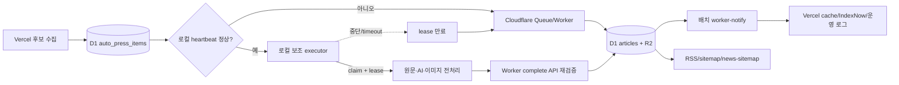

# CulturePeople 클라우드 주 실행·로컬 보조 기사 처리 기획서

- 작성일: 2026-08-07 KST
- 문서 성격: 개발 전 설계 및 운영 계획
- 적용 대상: CulturePeople auto-press, 기사 발행, 검색 색인 운영
- 핵심 원칙: **이 컴퓨터가 꺼져 있어도 웹서비스와 자동등록은 정상 작동한다.**

## 0. 경영진 요약

CulturePeople의 현재 auto-press는 Vercel이 후보를 수집해 D1에 넣고, Cloudflare Queue/Worker가 AI 편집·이미지 저장·기사 생성을 담당한다. 이미 Vercel에서 무거운 AI 직접 처리를 막고 Worker 배치 크기 3건, 일일 게시 30건으로 제한하고 있어 기본 방향은 적절하다.

이번 계획의 목표는 개인 컴퓨터를 새로운 필수 서버로 만드는 것이 아니다. 클라우드를 항상 주 실행기로 유지하면서, 컴퓨터가 켜져 있을 때만 다음 작업을 선택적으로 가져가게 하는 것이다.

1. 원문 추출
2. AI 편집
3. 이미지 다운로드·검사·변환
4. 품질 리포트 생성

로컬이 꺼지거나 네트워크가 끊기면 D1 lease가 만료되고 Cloudflare Worker가 자동 인계한다. 공개 사이트, 예약발행, RSS, sitemap, news-sitemap, IndexNow는 로컬 상태와 관계없이 계속 작동해야 한다.

바로 구현할 우선순위는 로컬 실행기보다 다음이 먼저다.

1. 기사별 `worker-notify`를 배치 통지로 변경해 Vercel 호출 수를 줄인다.
2. 실제 발행시각을 `created_at`/예약발행 시각 기준으로 일관되게 노출한다.
3. Google News 품질 게이트로 저가치 보도자료의 무분별한 발행을 줄인다.
4. 클라우드 단독 분산 발행을 먼저 검증한다.
5. 측정 결과 실익이 있을 때 로컬 보조 실행기를 활성화한다.

## 1. 목표와 제외 범위

### 1.1 목표

- 로컬 컴퓨터가 꺼져도 자동등록과 공개 사이트가 정상 작동한다.
- 로컬이 켜져 있으면 무거운 처리 일부를 가져가 Cloudflare/Vercel 순간 부하를 낮춘다.
- 같은 기사를 로컬과 클라우드가 동시에 처리해도 한 번만 게시된다.
- 기사 15~30건을 한 시점에 몰지 않고 설정된 슬롯으로 분산할 수 있다.
- 분산 발행은 검색 노출 조작 목적이 아니라 운영 안정성과 정확한 발행시각을 위한 기능으로 제한한다.
- 보도자료 전달, 편집·검증 기사, 자체 취재 기사를 구분한다.
- 실제 발행시각, 출처, AI 사용, 최종 검토 책임을 재현 가능하게 남긴다.

### 1.2 제외 범위

- 로컬 컴퓨터를 웹사이트 호스팅 서버로 사용
- 로컬 컴퓨터가 켜져 있어야만 예약발행 또는 auto-press가 작동하는 구조
- Google News 수동 송고 API 또는 존재하지 않는 등록 기능
- 보도자료를 단어만 바꿔 자체 기사처럼 위장하는 기능
- auto-news 재활성화
- 네이버뉴스·다음뉴스 자동 송고
- 로컬에 D1/R2/Cloudflare 관리자 권한 전체를 저장
- 기사 수를 늘리기 위한 무의미한 시간차 발행

## 2. 현재 상태

### 2.1 구현 완료 상태

| 영역 | 현재 구현 | 근거 |
|---|---|---|
| Vercel auto-press 후보 수집 | 하루 1회 `0 9 * * *` UTC | `vercel.json` |
| 기본 실행 모드 | 후보를 D1에 저장하는 `queue_only` | `src/app/api/cron/auto-press/route.ts` |
| Worker 예약 실행 | 10분마다, 일일 보고는 00:00 UTC | `cloudflare/auto-press-worker/wrangler.toml` |
| Worker 배치 | scheduled 최대 3건 | `AUTO_PRESS_WORKER_BATCH_SIZE=3` |
| Queue 배치 | 최대 3건, timeout 5초, 재시도 3회 | `wrangler.toml` |
| 일일 제한 | AI 50, 게시 30, 이미지 50 | `wrangler.toml` |
| 중복 실행 방지 | D1 `lease_until`, URL/제목 중복 검사 | Worker, migration `0003` |
| 장애 복구 기반 | retry, DLQ, 만료 lease 분류·복구 코드 | Worker 및 observability |
| 이미지 저장 | R2 `culturepeople` bucket | Worker binding |
| 기사 등록 | Worker가 D1 `articles`에 직접 저장 | Worker `saveArticle()` |
| 결과 통지 | 처리 완료 항목마다 Vercel `worker-notify` 호출 | Worker `processItemAndNotify()` |
| 공개 검색 표면 | RSS, sitemap, news-sitemap, NewsArticle | 기존 routes/article page |

### 2.2 이번 대화에서 확인한 라이브 상태

- `/news-sitemap.xml`, `/sitemap.xml`, `/rss.xml`, `/robots.txt`는 HTTP 200이다.
- 게시 기사에는 canonical, `index, follow`, NewsArticle JSON-LD가 있다.
- 최근 뉴스 사이트맵은 15건이며 모두 최근 48시간 범위다.
- 15건이라는 수는 Google News 기술 요건상 부족하지 않다. 뉴스 사이트맵에는 최근 2일 기사만 포함하는 것이 정상이다.
- 최근 15건은 한 차례 배치에서 수분 내 발행됐다.
- 기존 D1 기사 `date`는 날짜만 저장하고 `created_at`에는 실제 처리시각을 저장한다.

### 2.3 현재 로컬 변경 상태

실제 발행시각 계산은 다음 파일에 로컬 구현되어 있다.

- `src/lib/article-publication-date.ts`
- `src/app/article/[id]/page.tsx`
- `src/app/news-sitemap.xml/route.ts`
- CulturePeople/InsightKorea/Netpro 기사 화면
- Supabase feed fallback 조회

검증 결과는 unit 108파일/532테스트와 typecheck 통과다. 이 변경은 문서 작성 시점에 **운영 배포 여부를 별도로 확인해야 하며**, 배포 확인 전 완료로 간주하지 않는다.

### 2.4 미구현 항목

- 로컬 executor heartbeat/claim/complete API
- 로컬 Node 실행기
- 클라우드 자동 인계용 `cloud_fallback_at`
- 기사 처리 가능 시각 `available_at` 또는 `publish_after`
- Worker 결과 배치 통지
- 로컬 실행기 상태 관리자 UI
- 로컬/클라우드 실행 비용 비교 리포트
- Google News 전용 auto-press 품질 등급과 게이트

## 3. 현실적인 판단

### 3.1 로컬 보조 실행기가 필요한가

현재 무거운 AI·이미지 작업은 이미 Vercel이 아니라 Cloudflare Worker가 담당한다. 따라서 로컬 실행기는 Vercel 부하를 크게 줄이는 첫 번째 수단이 아니다. Vercel 호출 감소에는 **결과 배치 통지**가 더 단순하고 효과적이다.

로컬 실행기는 다음 조건에서 가치가 있다.

- Cloudflare Worker CPU/실행시간이 실제 운영 지표에서 증가한다.
- 원문 추출이나 이미지 변환이 Worker 제한에 자주 걸린다.
- AI 편집을 로컬에서 안정적으로 실행할 수 있다.
- 로컬 장애 시 클라우드 자동 인계가 검증돼 있다.

측정 없이 로컬 실행기를 먼저 만들면 운영 경로만 하나 더 늘고 장애 분석이 어려워질 수 있다.

### 3.2 시간차 발행이 필요한가

Google News는 기사를 일정한 간격으로 발행하라고 요구하지 않는다. 15건을 한 번에 게시했다고 바로 불이익을 받는 것도 아니다. 시간차 발행은 다음 목적으로만 사용한다.

- 순간 AI·이미지·DB 부하 완화
- 실제 발행시각 정확성
- 운영자가 품질을 확인할 시간 확보
- 소스별·주제별 과도한 연속 게시 방지

초기 권장값은 하루 최대 30건, 동시 1~3건을 유지하고 3~5개 발행 슬롯을 사용하는 것이다. 이 값은 Google 기준이 아니라 CulturePeople 운영 기준이다.

### 3.3 자체 기사화 방향

보도자료를 자체 기사처럼 보이게 하는 것은 목표가 아니다. AI는 다음 실질적 가치를 추가할 때만 편집·검증 기사 등급을 부여한다.

- 보도자료 외 독립 출처 확인
- 수치와 날짜 교차 확인
- 과거 사례·비교·문화적 맥락 추가
- 기관 주장과 편집부 확인 사실 분리
- 홍보·최상급·예측 표현 중립화
- 근거 URL과 확인 시각 보존
- 최종 편집자 승인

## 4. 목표 아키텍처



### 4.1 절대 불변 조건

- Cloudflare 경로는 항상 활성 상태를 유지한다.
- 로컬 heartbeat가 없으면 클라우드는 즉시 또는 정해진 짧은 유예 후 처리한다.
- 공개 사이트는 로컬 IP, 로컬 파일, 로컬 포트를 참조하지 않는다.
- 최종 기사 저장은 Worker가 검증하고 수행한다.
- 로컬이 완성 결과를 보내더라도 Worker가 차단 정책·중복·일일 제한·payload schema를 다시 검사한다.

### 4.2 실행 상태 모델

| 상태 | 의미 | 다음 동작 |
|---|---|---|
| `queued` | 후보 저장 완료 | `available_at`까지 대기 |
| `local_preferred` | 로컬 우선 처리 가능 | heartbeat가 정상일 때 로컬 claim |
| `cloud_ready` | 즉시 클라우드 처리 가능 | Queue/Worker claim |
| `leased_local` | 로컬이 제한 시간 점유 | complete 또는 lease 만료 |
| `leased_cloud` | Worker가 점유 | 기존 처리 수행 |
| `prepared` | 편집·이미지 결과 검증 대기 | Worker 최종 저장 |
| `published` | 기사 등록·통지 완료 | 검색 표면 반영 |
| `retry_wait` | 제한적 재시도 대기 | `next_retry_at` 이후 처리 |
| `failed`/`dlq` | 자동 처리 종료 | 운영자 검토 |

실제 구현에서는 기존 `queued/running/ok/fail/skip` 호환성을 유지하고 executor와 phase를 별도 컬럼으로 추가하는 방식을 우선한다. 기존 상태 문자열을 한 번에 교체하지 않는다.

## 5. D1 데이터 설계

신규 additive migration 후보: `cloudflare/d1/migrations/0007_hybrid_executor_schedule.sql` (**신규 구현 필요**)

### 5.1 `auto_press_items` 추가 후보

| 컬럼 | 용도 |
|---|---|
| `available_at TEXT` | 처리 시작 가능 시각 |
| `preferred_executor TEXT` | `cloud`, `local_preferred` |
| `executor_id TEXT` | 점유한 실행기 식별자, 개인정보 없는 임의 ID |
| `executor_type TEXT` | `cloud_queue`, `cloud_scheduled`, `local` |
| `claim_token_hash TEXT` | complete 요청의 점유권 검증 |
| `cloud_fallback_at TEXT` | 로컬 미응답 시 클라우드 인계 시각 |
| `prepared_result_json TEXT` | 크기 제한된 편집 결과 또는 R2 artifact 포인터 |
| `notify_pending INTEGER` | Vercel 배치 통지 대기 여부 |

`cloud_fallback_at`은 후보 생성 시점에 로컬 heartbeat가 이미 정상이었을 때만
"생성 후 20분" 규칙을 적용한다. 후보 생성 시점에 heartbeat가 이미 stale이거나
없으면 `local_preferred`로 넣고 20분을 기다리지 않고, 곧바로 `cloud_ready`로
시작해 즉시 처리 대상이 되게 한다. 그렇지 않으면 컴퓨터가 오래 꺼져 있는 흔한
경우에도 신규 후보마다 불필요한 20분 지연이 생겨, 0번 문서의 핵심 원칙("컴퓨터가
꺼져 있어도 정상 작동")과 4.1의 "즉시 또는 짧은 유예"라는 절대 불변 조건에 어긋난다.

인덱스 후보:

```sql
CREATE INDEX idx_auto_press_items_executor_due
ON auto_press_items(status, available_at, cloud_fallback_at, lease_until, priority);

CREATE INDEX idx_auto_press_items_notify_pending
ON auto_press_items(notify_pending, completed_at);
```

### 5.2 로컬 executor 상태 테이블

`auto_press_executors` (**신규 구현 필요**)

- `executor_id` TEXT PK
- `status` TEXT: `active`, `draining`, `disabled`
- `capabilities_json`: source, AI, image 기능
- `last_heartbeat_at`
- `lease_count`, `success_count`, `failure_count`
- `version`, `platform`
- `created_at`, `updated_at`

호스트명, 사용자명, 전체 IP, secret 원문은 저장하지 않는다. IP가 감사상 필요하면 일방향 hash와 짧은 보관기간만 허용한다.

## 6. 로컬 보조 실행기

### 6.1 실행 방식

- 신규 파일 후보: `scripts/culturepeople-local-executor.mjs`
- 신규 package script 후보: `ops:local-executor` (**신규 구현 필요**)
- 기본값은 `--dry-run` 또는 `--once`다.
- Linux에서는 user systemd timer/service, Windows에서는 Task Scheduler를 제공한다.
- 항상 실행되는 daemon보다 2~5분 간격의 짧은 단발 실행을 우선 검토한다.

### 6.2 API 후보

모든 API는 Cloudflare Worker에 두고 Vercel을 거치지 않는다.

- `POST /local-executor/heartbeat`
- `POST /local-executor/claim`
- `POST /local-executor/complete`
- `POST /local-executor/fail`
- `POST /local-executor/drain`

기본 권장값:

- heartbeat: 5분
- heartbeat stale: 12분
- local lease: 15분
- cloud fallback: 후보 생성 후 20분
- local concurrency: 1
- claim batch: 1, 안정화 후 최대 2
- complete payload 제한: 명시적 byte limit 적용

### 6.3 보안

- `CULTUREPEOPLE_LOCAL_EXECUTOR_TOKEN`은 전용 scope로 발급한다.
- Cloudflare API token, D1 token, R2 관리자 key를 로컬 실행기에 주지 않는다.
- token은 hash 비교하고 로그에는 마지막 4자도 출력하지 않는다.
- claim 응답은 해당 작업에 필요한 최소 필드만 제공한다.
- complete는 claim token, item ID, checksum, lease 유효성, payload schema를 모두 검증한다.
- AI key를 로컬에서 사용할 경우 운영 Worker key와 분리하고 일일 한도를 별도로 둔다.
- Linux env 파일 권한은 `600`, Windows는 사용자 계정의 Credential Manager 또는 제한된 환경 설정을 사용한다.

### 6.4 로컬 중단 시 동작

0. 후보 생성 시점에 heartbeat가 이미 stale이거나 기록이 없으면 `local_preferred`
   단계와 20분 대기를 건너뛰고 곧바로 `cloud_ready`로 생성한다(5.1 참고). 아래
   1~6번은 생성 시점에는 heartbeat가 정상이었다가 이후 응답이 끊긴 경우다.
1. heartbeat가 12분 이상 갱신되지 않는다.
2. 신규 후보는 `local_preferred`로 남겨두지 않고 cloud ready로 전환한다.
3. 기존 local lease는 최대 15분 후 만료된다.
4. 10분 Worker cron이 만료 작업을 가져간다.
5. 최악의 정상 인계 목표는 약 20~30분이다.
6. 긴급/우선순위 기사는 local grace를 사용하지 않고 즉시 cloud queue로 보낸다.

## 7. 클라우드 처리와 Vercel 부하 절감

### 7.1 Worker 결과 배치 통지

현재는 완료 item마다 `/api/auto-press/worker-notify`를 호출한다. 15건이면 약 15회 Vercel 함수 호출이 발생할 수 있다.

목표:

- Queue batch 또는 scheduled batch 최대 3건을 한 번에 통지
- 신규 endpoint 후보: `/api/auto-press/worker-notify/batch`
- 또는 기존 endpoint가 `{ items: [...] }`를 additive하게 지원
- 최대 10건, payload size 제한, idempotency key 적용
- 기사별 로그는 유지하되 IndexNow URL은 한 요청으로 묶는다.
- 일부 실패 시 성공 item을 다시 처리하지 않도록 item별 결과를 반환한다.

15건 기준 목표 Vercel 통지 호출은 15회에서 약 5회 이하로 줄인다.

### 7.2 분산 처리

초기 예시 슬롯:

| KST | 최대 건수 | 비고 |
|---|---:|---|
| 09:00 | 3 | 오전 문화 소식 |
| 10:30 | 3 | 출판·전시 |
| 12:00 | 3 | 공연·생활문화 |
| 14:30 | 3 | 기업·기관 문화사업 |
| 17:00 | 3 | 잔여 후보 |

슬롯은 관리자 설정으로 변경 가능하게 하되, 처음에는 코드 상수가 아니라 D1 설정 + 검증된 기본값을 사용한다. 긴급성이 없는 보도자료의 최대 지연은 같은 영업일 안으로 제한한다.

### 7.3 호출하지 않아야 하는 경로

- 로컬이 매 기사마다 Vercel auto-press route 호출
- 로컬이 공개 기사 페이지를 반복 크롤링
- Google sitemap을 매 기사마다 재제출
- IndexNow를 같은 URL로 반복 제출
- 로컬이 D1 HTTP API에 raw SQL 직접 전송

## 8. Google News 및 편집 품질

### 8.1 기사 수 판단

- 최근 48시간 15건은 부족 판정 근거가 아니다.
- Google 뉴스 사이트맵의 목적은 최근 2일 기사를 알려주는 것이며 최소 건수는 없다.
- 더 많이 게시할 수는 있지만 기사 수 자체를 목표로 하지 않는다.
- 하루 30건 상한은 서버 보호뿐 아니라 저가치 대량 생성 방지 장치로 유지한다.

### 8.2 품질 등급

| 등급 | 조건 | Google News 처리 권장 |
|---|---|---|
| `press_relay` | 단일 보도자료를 중립적으로 정리 | 원문 유사·추가가치 부족 시 News 제외 검토 |
| `edited_verified` | 독립 출처, 비교, 사실 확인, 편집자 검토 | 품질 gate 통과 시 후보 |
| `original_reporting` | 인터뷰·현장·자체 데이터·독자 관점 | 우선 후보 |

### 8.3 auto-press 품질 게이트

**신규 구현 필요**:

- 원문 유사도와 반복 문구
- 독립 출처 수와 출처 독립성
- 홍보성 제목·최상급·구매 유도 표현
- 기관 주장과 확인 사실 구분
- 숫자·날짜·인용문의 근거 연결
- 이미지 제공처와 사용 권리
- 기사 유형과 AI 보조 여부
- 최종 검토자와 검토 시각
- 실제 발행시각

기준 미달 기사를 Google Search 전체에서 제거하는 것은 자동 결정하지 않는다. 명백한 재게시·저가치 전달 기사에는 `Googlebot-News: noindex` 적용을 검토하되, 초기에는 report-only로 운영한다.

## 9. 단계별 개발 계획

### P0. 기준선과 실제 발행시각

- **목적**: 부하 개선 전후를 수치로 비교하고 날짜 오류를 먼저 제거한다.
- **현재 상태**: 발행시각 공통 계산은 로컬 구현·테스트 완료, 운영 배포 확인 필요.
- **개발 범위**: Worker/Vercel 호출 수, duration, D1 query, publish 수 7일 기준선; 발행시각 배포 및 라이브 확인.
- **제외**: 운영 DB 과거 기사 일괄 수정.
- **완료 기준**: 신규 기사 화면·JSON-LD·뉴스 사이트맵의 시각이 동일하고 KST 실제 시각과 일치.
- **rollback**: 공통 resolver 적용 commit/배포만 되돌리고 DB는 손대지 않는다.

### P1. Worker 결과 배치 통지

- **목적**: 가장 낮은 복잡도로 Vercel 호출을 감소시킨다.
- **예상 파일**: Worker `src/index.js`, `worker-notify` route, portal publication helper, tests.
- **신규 명령 후보**: `pnpm check:auto-press-notify-batch`.
- **완료 기준**: 15건 처리 시 Vercel 통지 5회 이하, 기사 누락·중복 0.
- **중단 조건**: 부분 실패 재시도에서 중복 IndexNow 또는 로그 중복 발생.
- **rollback**: feature flag로 기존 item별 notify 복구.

### P2. 클라우드 단독 `available_at` 분산 처리

- **목적**: 로컬 없이도 순간 부하를 분산한다.
- **예상 파일**: migration `0007`, Worker due query, queue enqueue, auto-press settings/UI, tests.
- **기본값**: 기능 off, 기존 즉시 처리 유지.
- **완료 기준**: due 이전 처리 0, due 후 다음 Worker invocation에서 처리, 일일 제한 유지.
- **중단 조건**: 30분 이상 이유 없는 지연 또는 긴급 기사 지연.
- **rollback**: flag off 시 모든 queued item을 기존 due 조건으로 처리.

### P3. 로컬 watchdog

- **목적**: 로컬 처리 전에 클라우드 장애 감시와 복구 트리거를 검증한다.
- **예상 파일**: `scripts/culturepeople-local-worker-watchdog.mjs`, systemd/Windows 문서.
- **동작**: `/health`와 최근 runtime만 확인, stale일 때만 인증된 제한 호출 1회.
- **완료 기준**: 정상 상태에서는 쓰기 0, stale 상태에서 중복 없는 복구 요청 1회.
- **rollback**: timer 비활성화만으로 즉시 제거 가능.

### P4. 로컬 executor shadow

- **목적**: 운영 게시 없이 로컬 처리 결과와 Worker 결과를 비교한다.
- **예상 파일**: migration, Worker local API, local executor script, env drift check, report.
- **운영**: 최초 7일 `report-only`, concurrency 1, 기사 저장 금지.
- **완료 기준**: 성공률 95% 이상, checksum 일치, secret 노출 0, cloud fallback 검증 통과.
- **중단 조건**: 중복 claim, 잘못된 기사 결과, 장기 lease, 로컬 종료 후 인계 실패.

### P5. 로컬 executor 제한 활성화

- **목적**: 측정상 효과가 있을 때 저위험 작업부터 로컬로 이동한다.
- **초기 범위**: 원문 추출·품질 검사. AI/이미지는 후속 승인.
- **완료 기준**: 클라우드 무거운 실행시간 감소, 게시 지연 SLA 유지, 장애 시 30분 내 인계.
- **rollback**: executor status `draining/disabled`, 모든 후보 cloud ready 전환.

### P6. Google News 품질 gate

- **목적**: 수량보다 독창성·투명성·근거 품질을 관리한다.
- **운영 순서**: report-only 30일 → 편집자 검토 → 저위험 block/allow 규칙 승인.
- **완료 기준**: unsupported claim, 고유사도, 홍보성 제목 지표와 편집자 판정 일치율 확보.
- **중단 조건**: 정당한 공익·문화 기사를 자동 제외하거나 출처를 숨기는 결과.

## 10. 테스트 계획

### 10.1 단위 테스트

- lease 획득 경쟁: local/cloud 중 하나만 성공
- heartbeat fresh/stale 경계
- local lease 만료 후 cloud fallback
- duplicate completion과 idempotency
- batch notify 전체/부분 실패
- `available_at` 이전/이후 due query
- 일일 AI·게시·이미지 제한
- 차단 정책과 품질 gate
- 실제 발행시각과 과거 이관 기사 보호
- secret redaction

### 10.2 통합 테스트

1. 테스트 D1에 후보 6건 생성
2. 로컬 off에서 Worker가 전부 처리
3. 로컬 heartbeat on에서 3건 local claim, 나머지 cloud fallback
4. 로컬을 강제 종료하고 lease 만료 확인
5. 기사 no·source URL 중복 0 확인
6. worker-notify가 2회 이하인지 확인
7. RSS/sitemap/news-sitemap 및 NewsArticle 검증

### 10.3 부하 검증

- Vercel 함수 호출 수와 duration 전후 비교
- Worker CPU time, invocation, subrequest 비교
- D1 read/write row 수 비교
- R2 operation과 저장량 비교
- 15건/30건 시나리오를 테스트 D1 또는 dry-run으로 검증
- 라이브 대량 기사 생성은 금지

## 11. 명령 계획

현재 존재하는 명령:

```bash
pnpm check:auto-press-agent-loop
pnpm auto-press:stale-recovery -- --dry-run
pnpm verify:portal -- --base https://culturepeople.co.kr
pnpm ci:typecheck
pnpm test:unit
```

신규 구현 필요:

```bash
pnpm auto-press:load-baseline -- --days 7 --dry-run
pnpm check:auto-press-notify-batch
pnpm auto-press:schedule:audit -- --days 2
pnpm ops:local-worker:watchdog -- --once --dry-run
pnpm ops:local-executor -- --once --dry-run
pnpm ops:local-executor -- --once --apply
pnpm ops:local-executor:status
pnpm auto-press:google-news-quality -- --days 2 --report-only
```

모든 신규 명령은 Linux/Windows 공통 Node 스크립트로 구현하고 path separator와 shell 전용 문법에 의존하지 않는다.

## 12. 운영 및 장애 Runbook

### 로컬 컴퓨터가 꺼짐

- 조치 없음.
- Worker heartbeat stale 판단 후 cloud ready 처리.
- 30분 이상 queued 증가 시 Telegram 경고.

### 로컬이 작업 중 종료

- 읽기 전용 확인: executor heartbeat, item lease, event log.
- lease 만료를 기다린다.
- 자동 인계 실패 시 bounded stale recovery를 dry-run 후 적용한다.

### Cloudflare Worker 장애

- 공개 사이트는 계속 제공돼야 한다.
- 로컬은 최종 DB 직접 쓰기를 하지 않는다.
- 후보는 D1 queued로 보존하고 Worker 복구 후 처리한다.
- 로컬이 결과를 준비했다면 checksum artifact만 보존하고 complete를 재시도한다.

### Vercel 장애

- Worker 기사 저장은 가능하더라도 notify pending을 남긴다.
- Vercel 복구 후 batch notify를 재실행한다.
- notify 실패를 기사 게시 실패로 되돌리지 않는다.
- sitemap이 DB를 읽어 새 기사를 노출하는지 별도 확인한다.

### 로컬 secret 유출 의심

- executor를 D1에서 disabled 처리한다.
- 전용 token만 회전한다.
- Cloudflare/D1/R2 전체 key 회전을 기본 조치로 삼지 않는다.
- 감사 로그에서 claim/complete 범위를 확인한다.

## 13. 성공 지표

| 지표 | 목표 |
|---|---:|
| 로컬 off 상태 자동 처리 성공률 | 기존 수준 이상 |
| cloud fallback 시간 | 정상 조건 30분 이내 |
| 중복 게시 | 0 |
| 15건 Vercel notify 호출 | 5회 이하 |
| 로컬 executor concurrency | 초기 1 |
| 일일 게시 상한 | 30 유지 |
| 잘못된 실제 발행시각 | 0 |
| News sitemap 최근 48시간 규칙 위반 | 0 |
| secret 원문 로그 | 0 |
| 품질 gate false block | shadow 단계에서 편집자 허용치 이하 |

## 14. 대표자 결정 항목

- 로컬 보조 실행기로 먼저 옮길 범위: 원문 추출만 / AI 포함 / 이미지 포함
- 로컬 Gemini 별도 key와 일일 한도
- 기사 분산 슬롯 사용 여부와 시간대
- 긴급 기사의 cloud 즉시 처리 기준
- 보도자료 전달 기사에 표시할 자료제공·AI 보조 문구
- `press_relay`의 Google News 제외 정책
- 로컬 executor 로그 보관기간
- 실제 Cloudflare/Vercel 비용과 부하가 로컬 실행기 복잡성을 정당화하는지

## 15. 가장 먼저 개발할 작업

**P1 Worker 결과 배치 통지**를 먼저 구현한다.

이유:

- 로컬 컴퓨터 상태와 무관하다.
- Vercel 호출 감소 효과가 명확하다.
- 기존 Queue batch 3건 구조와 잘 맞는다.
- DB schema 변경 없이 additive API로 시작할 수 있다.
- feature flag로 즉시 rollback할 수 있다.

그다음 실제 발행시각 운영 배포를 확인하고, 클라우드 단독 `available_at` 분산 처리를 구현한다. 로컬 executor는 7일 부하 기준선과 shadow 검증 뒤 활성화한다.

## 16. 다음 개발 프롬프트

### 16.1 1단계: 결과 배치 통지와 발행시각

```text
docs/culturepeople-hybrid-local-cloud-publishing-plan.md의 P0/P1을 기준으로 실제 발행시각 운영 반영과 Worker 결과 배치 통지를 구현해줘. 기존 item별 notify는 feature flag fallback으로 유지하고, Queue/scheduled batch 최대 3건을 한 번에 Vercel로 통지해. 기사별 idempotency, 부분 실패 재시도, IndexNow URL batch, 로그 정합성을 구현하고 unit/typecheck/Worker dry-run/소량 운영 검증까지 완료해. 운영 DB 대량 쓰기는 하지 마.
```

### 16.2 2단계: 클라우드 단독 분산 처리

```text
docs/culturepeople-hybrid-local-cloud-publishing-plan.md의 P2를 구현해줘. additive D1 migration으로 available_at과 cloud fallback 기반을 추가하고, feature flag off를 기본값으로 유지해. Cloudflare Worker만으로 due 기사 1~3건을 처리하며 Vercel cron을 늘리지 마. 긴급 기사 bypass, 일일 30건 제한, lease/idempotency, dry-run schedule audit, rollback을 구현하고 테스트 D1 검증 후 안전하게 배포해.
```

### 16.3 3단계: 로컬 watchdog과 executor shadow

```text
docs/culturepeople-hybrid-local-cloud-publishing-plan.md의 P3/P4를 구현해줘. 웹서비스는 항상 Cloudflare가 주 실행기여야 하고 로컬은 선택적 보조 실행기로만 동작하게 해. Worker heartbeat/claim/complete API와 Node 로컬 executor를 구현하되 D1/R2 관리자 key를 로컬에 저장하지 마. Linux systemd user timer와 Windows Task Scheduler 절차를 제공하고, 기본은 report-only/concurrency 1로 유지해. 로컬 종료, 네트워크 단절, lease 만료, cloud fallback, 중복 complete를 테스트하고 운영 게시 없이 shadow 결과만 보고해.
```

## 17. 완료 정의

전체 계획은 다음 조건을 모두 충족해야 완료다.

- 로컬 컴퓨터를 끈 상태로 24시간 자동 처리 검증 통과
- 로컬을 켠 상태에서 제한된 작업이 로컬로 분배됨
- 로컬 강제 종료 후 30분 내 클라우드 자동 인계
- 중복 기사 0, 유실 기사 0
- Vercel item별 notify가 batch로 감소
- 실제 발행시각이 화면·Open Graph·NewsArticle·뉴스 사이트맵에서 일치
- 보도자료 품질 등급과 Google News 후보 기준이 운영자에게 보임
- Linux와 Windows 절차 모두 검증됨
- release manifest, rollback, secret redaction, 운영 로그가 남음

